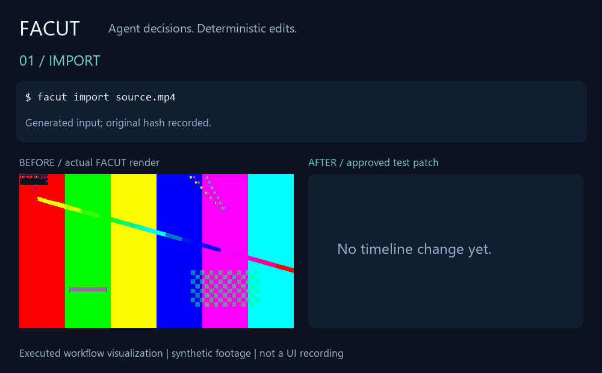

# FACUT · Fast AI Cut

**给 AI Agent 用的视频剪辑工具，让人类保留批准权。**

[](https://github.com/SystemZion/facut/actions/workflows/tests.yml)
[](https://github.com/SystemZion/facut/releases/latest)

[English](README.md) · 简体中文

AI 负责理解画面和创作判断；FACUT 负责验证证据、确定性执行和回滚。
不改变原始素材，不把“自动化”冒充“已经审片”。

**意见 → Timeline Patch → 审片 → 批准 → 输出**



这是可复现工作流的可视化，不是审片室录屏。前后画面来自真实 FACUT
渲染的合成测试素材，不使用旅行画面或个人录音。
[复现演示](examples/homepage-demo/README.md)。

[Windows 下载](https://github.com/SystemZion/facut/releases/latest) ·
[快速开始](docs/getting-started.md) ·
[Agent 接口](docs/agent-api.md) ·
[完整中文手册](docs/handbook.zh-CN.md)

## 为什么使用它？

| 特点 | 含义 |
|---|---|
| Agent 原生 | 稳定素材 ID、JSON Schema、原子批处理、常驻 JSON-RPC |
| 确定性执行 | 外部 AI 提交结构化意图，FACUT 验证后执行 |
| 人类在环 | 意见、差异、实际预览、批准和实验分支各自留痕 |
| 非破坏 | 原视频只读，编辑保存在独立工程和历史中 |
| 本地优先 | 本地 FFmpeg、127.0.0.1 令牌认证审片室、独立可选模型 |

适合旅行 VLOG、日常故事及可重复剪辑流程。不是“一句命令就能独立理解
几千条素材并自动做好影片”的承诺。云端 Agent 可能传输你交给它的证据，
“本地优先”不代表外部 Agent 自动获得离线隐私保证。

## 安装与第一次剪辑

Windows 下载完整便携 ZIP 并解压；不要只拿走 facut.exe。
运行库、FFmpeg/FFprobe、原生加速器和许可证需保留在包内。
声音与字幕识别模型独立下载。

现有1.0.0便携包的 Patch 返回值格式问题已在本次源码中修复，
但尚未重新打包；[下载包边界](docs/limitations.md)。

macOS/Linux 使用 Python 3.11+ 包，并安装现代 FFmpeg/FFprobe：

```bash
git clone https://github.com/SystemZion/facut.git
cd facut
python -m pip install .
facut doctor
```

一个至少六秒的测试视频：

```powershell
facut init demo
facut --json -p demo import input.mp4
facut -p demo timeline track add --type video --name V1
# 用 import 返回的素材 ID 替换 MEDIA_ID。
facut -p demo timeline add MEDIA_ID --track V1 --at 0 --in 1s --out 6s
facut -p demo preview timeline --output demo/previews/review.mp4
facut -p demo review open
# 看过预览后再输出。
facut -p demo render --hardware none --output demo/renders/final.mp4
```

旅行项目先 `scan`，由外部 Agent 提交实际观察，再按 `next` 推进；
证据不足会要求复审，不会伪造成功。

## 核心能力

Scene Atlas 素材呈现与证据、非破坏时间线、CutGraph 分支历史、审片室、
字幕/标题/字体、授权音乐库、可选本人声音、Recipe、代理、QC、
OTIO/FCPXML 交换。

`edit` 保存自然语言意见，由外部 Agent 生成 Patch。
`review patch preview` 返回差异和变化区间，**不是直接生成 A/B 视频**。
[完整审片流程](docs/director-studio.md)。

## 边界与可信度

不内置语言模型或通用视觉模型；AI 观察与人类审片决定创作质量。
最终主编码为 H.264/AAC；FCPXML 有损；含转场的增量渲染可能降级；
HDR→SDR 不可默认自动完成；无主体轨迹时不能宣称智能重构图。
[详细限制](docs/limitations.md)。

首页 CI 徽章链接实际结果，不把旧测试次数当永久指标。
源码为 MIT，第三方工具、字体、模型、音乐各按自身许可证使用。

[文档目录](docs/index.md) · [开发架构](docs/architecture.md) ·
[反馈问题](https://github.com/SystemZion/facut/issues)
